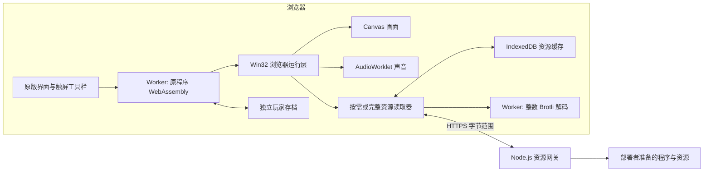

# Joey Browser

**在浏览器中运行《游戏王：混沌力量 · 城之内篇》的原版程序。**

[](https://github.com/Junming-Liang/joey-browser/actions/workflows/checks.yml)
[](CHANGELOG.md)
[](LICENSE)
[](docs/BUILD.md)
[](docs/VERIFICATION.md)

[在线体验](https://106.12.148.75:8443/joey/original/) · [快速开始](#快速开始) · [构建](docs/BUILD.md) · [部署](docs/DEPLOY.md) · [更新日志](CHANGELOG.md) · [提交问题](https://github.com/Junming-Liang/joey-browser/issues)

Joey Browser 将固定版本的原程序静态转换为 WebAssembly，在浏览器里执行原有界面、规则和 AI。Canvas 显示原版画面，Web Audio 播放原版混音，服务器提供程序和资源字节。手机与电脑使用同一套运行层。

仓库提供网页运行层、Win32 兼容补丁、资源压缩工具和验证脚本。[完整部署附件](https://github.com/Junming-Liang/joey-browser/releases/download/v0.2.1/joey-browser-v0.2.1-complete.tar.gz) 包含原版 EXE、完整资源字节和预编译浏览器程序，可直接安装；Git 源码保持独立。游戏内容与 MIT 自有代码的许可边界见 [内容声明](GAME-CONTENT-NOTICE.md)。

## 目录

- [功能](#功能)
- [快速开始](#快速开始)
- [资源安装](#资源安装)
- [架构](#架构)
- [构建与部署](#构建与部署)
- [开发与测试](#开发与测试)
- [项目结构](#项目结构)
- [当前状态](#当前状态)
- [常见问题](#常见问题)
- [贡献](#贡献)
- [许可与致谢](#许可与致谢)

## 功能

- **原版程序运行**：保留菜单、卡组管理、决斗流程和城之内 AI；原始画布为 800 × 600。
- **手机操作**：横屏缩放、点按、拖动、右键辅助、回车、空格、返回与设备键盘。
- **原版声音**：PCM 混音通过 AudioWorklet 播放，提供声音恢复按钮。
- **按需资源**：默认先准备常用资源，其他素材随游戏读取；音乐采用小范围读取和预取。
- **可选完整安装**：提供约 180 MB 的轻量资源和约 228 MB 的原画原声资源。
- **缓存与续传**：程序、资源及未完成的下载分段保存在浏览器中，旧完整缓存直接复用。
- **独立存档**：玩家文件与资源缓存分开保存；浏览器标签协调独占写入。
- **全卡与卡组**：原版 771 种卡片解锁、45 套兼容预设卡组及收藏／卡组备份恢复。
- **运行诊断**：下载进度、缓存、渲染、音频和错误信息可复制反馈。

当前原版入口以与城之内 AI 决斗为主；双人联网决斗尚未纳入本仓库的验证范围。

## 快速开始

### 直接体验

1. 打开 [在线体验](https://106.12.148.75:8443/joey/original/)，手机建议横屏。
2. 点击 **启动原版游戏**。当前演示入口无需密码。
3. 使用屏幕上的原版界面操作；工具栏提供右键、键盘和常用按键。

默认采用按需加载。首次启动的程序与常用资源压缩传输预计约 50 MB，后续再读取未缓存内容；这是固定资源片段的压缩估算，实际传输随缓存和网络响应变化。

勾选完整安装后，可以在 **完整资源画质** 中选择轻量或原画原声。已安装的完整旧资源会直接复用，更新无需清除网站数据或重新下载全部内容。

### 直接部署

在 [v0.2.1 Release](https://github.com/Junming-Liang/joey-browser/releases/tag/v0.2.1) 下载完整部署包及其 `.sha256` 校验文件。目标服务器仅需 Node.js 22 及以上：

```sh
sha256sum -c joey-browser-v0.2.1-complete.tar.gz.sha256
tar -xzf joey-browser-v0.2.1-complete.tar.gz
cd joey-browser-v0.2.1-local
node site/setup-deployment.mjs --origin https://game.example.com
JOEY_ORIGINAL_CONFIG="$PWD/config.local.json" \
  node --max-old-space-size=64 site/server.mjs
```

安装器无损还原原始资源、校验文件并生成独立配置，目标机无需编译 Rust。公网手机访问需按 [完整部署说明](docs/LOCAL-DEPLOYMENT.md) 配置 HTTPS 代理；服务默认绑定回环地址。

### 获取源码

源码检查需要 Node.js 22 及以上、Python 3；完整资源构建的固定环境见 [构建文档](docs/BUILD.md)。

```sh
git clone https://github.com/Junming-Liang/joey-browser.git
cd joey-browser
npm ci
npm test
```

上述命令检查源码和离线契约。从源码重建时需准备版本匹配的游戏输入和工具链；使用完整部署附件可直接进入安装流程。

## 资源安装

| 方式 | 下载范围 | 适合场景 |
| --- | --- | --- |
| 按需加载，默认 | 程序与首批常用资源预计约 50 MB；其余随后读取 | 希望尽快进入游戏 |
| 完整轻量资源 | 资源包及索引、解码器约 180.0 MB | 希望减小完整安装体积 |
| 完整原画原声 | 资源包及索引、解码器约 228.4 MB | 希望保留原始素材精度 |

完整资源数字不包含两档共用的游戏程序；程序 gzip 约 16.1 MB。两档沿用同一批原始资源、文件大小和目录偏移。相比当前原画原声包，轻量安装少约 48.3 MB，减少约 21.2%。[测量口径与原始数据](docs/RESOURCE-PACKS.md#测量口径)。

轻量档仅处理 **776 幅卡图** 和 **131 个 WAV 的 PCM 数据**：卡图每通道保留高 6 位、音频保留 13 位有效精度。界面图片、背景、文字、字体、卡背、遮罩、透明素材，以及音频的采样率、声道和时长保持原样。

资源以独立压缩块保存，游戏仍按原文件偏移读取。安装完成前会逐块校验持久化数据；下载中断后继续读取尚未保存的部分。已有完整原版缓存优先复用；选择原画原声时不会使用轻量缓存替代。

## 架构

游戏逻辑、画面生成和混音在访问者的浏览器中运行。资源网关负责提供带身份校验的静态文件与字节范围。



转换器与基础 Win32 兼容层来自固定提交的 [Theseus](https://github.com/evmar/theseus)。本项目维护游戏适配补丁、浏览器输入／绘图／音频接口、资源读取和存档管理。

手机访问要求 HTTPS 安全上下文，以及 COOP／COEP 跨源隔离。运行层需要 WebAssembly 共享内存、Worker、AudioWorklet、IndexedDB 和原生解压能力。能力不足或存储不可用时，页面会提供运行诊断；完整安装依赖持久存储。

## 构建与部署

| 文档 | 内容 |
| --- | --- |
| [BUILD.md](docs/BUILD.md) | 原始输入、固定工具链、兼容补丁、程序转换和资源包生成 |
| [DEPLOY.md](docs/DEPLOY.md) | 本地配置、资源目录、HTTPS、systemd、发布与回滚 |
| [LOCAL-DEPLOYMENT.md](docs/LOCAL-DEPLOYMENT.md) | 用本地游戏输入生成完整部署包，目标机无需重新编译 |
| [RESOURCE-PACKS.md](docs/RESOURCE-PACKS.md) | 压缩格式、轻量策略、缓存身份、续传和体积口径 |
| [VERIFICATION.md](docs/VERIFICATION.md) | 已完成的验证、环境和当前限制 |
| [version.json](version.json) | 运行版本、源文件、兼容补丁与资源包固定哈希 |

部署脚本使用独立服务和回环端口，发布失败时恢复配置。完整轻量包与原画包分别安装在以哈希命名的目录，原画包是当前质量选项的必需资源；旧包保留供缓存续传和代码回滚使用。

已准备游戏输入和构建产物的部署者，可用 `npm run package:local -- --output .bridge/local-deployment.tar.gz` 生成本机完整包。安装器从无损包还原原资源并核对哈希，目标机器仅需 Node.js；游戏版权内容不随公开源码发行。

## 开发与测试

### 无需游戏文件的检查

```sh
npm test
```

包括 JavaScript 语法与来源校验、资源网关范围读取契约、PCM 队列与边界、安装器无损还原和文件保护，以及部署归档校验和回滚的离线测试。CI 执行这一层检查。

### 构建后的浏览器检查

```sh
npx playwright install --with-deps chromium webkit
npm run test:downloads
npm run test:startup
npm run test:quality
npm run test:decoder
npm run test:install
npm run test:game
```

完整检查需要本机固定游戏输入和构建输出。测试使用专用存档和浏览器上下文；`JOEY_CHROMIUM_PATH` 可指定现有 Chromium。测试结果应区分桌面浏览器的触控模拟与实体手机。

## 项目结构

```text
.
├── games/joey/
│   ├── original/       # 原版网页、Worker、存档、服务与浏览器检查
│   └── reverse/        # 兼容补丁、转换与资源压缩工具
├── build-inputs/        # 固定版本的转换入口和导入审计
├── deploy/              # 反向代理与独立服务示例
├── docs/                # 构建、部署、资源与验证文档
├── scripts/             # 源码与来源检查
├── releases/            # 版本说明
├── CHANGELOG.md
├── CONTRIBUTING.md
├── LICENSE
├── THIRD_PARTY_NOTICES.md
└── version.json
```

`.bridge/` 是本地构建和测试工作目录，原游戏文件、生成程序、资源包和浏览器数据均不提交到仓库。唯一随源码发布的 WASM 是声明来源及许可的 Brotli 解码器。

## 当前状态

`v0.2.1` 对应运行版本 **`20261015-131102-786bb37f`**，目前作为兼容性预览维护。

已在 Chromium 和 WebKit 中验证完整资源的 458 个块、实际下载中断后的续传、旧缓存兼容、质量选择隔离、错误解码与取消、存档保持，以及卡组界面中的持续音乐播放。公网 HTTPS 上的两档资源读取和程序启动也已验证。

完整胜负与奖励、所有卡片效果、全部重放流程、中文输入法和所有实体手机的流畅度仍需继续验证。当前键盘输入支持英文、数字和常见英文标点。详细范围见 [验证记录](docs/VERIFICATION.md)。

## 常见问题

**安卓内置网页提示缺少共享内存怎么办？**

请复制网址到独立 Chrome 浏览器打开，或使用所在应用菜单的“在浏览器中打开”。游戏根据真实的安全上下文、跨源隔离和共享内存能力判断是否可启动；同一内核版本的应用内置网页与独立浏览器可能开放不同能力。

**为什么刷新后不必重新下载完整资源？**

程序和资源分段保存在当前站点的 IndexedDB 中，完成标记与资源身份绑定。刷新后复用这些字节；清除网站数据、切换域名或浏览器回收存储会影响缓存和存档。

**旧缓存会被强制替换成轻量版吗？**

完整旧资源会继续使用；旧包下载到一半也可以续传。轻量版主要降低新完整安装的下载量，资源缓存仍受浏览器配额及既定容量策略限制。

**能直接打开 HTML 或放到普通静态托管上吗？**

完整运行需要资源范围接口、正确响应头、持久化资源身份和跨源隔离。请按部署文档提供匹配的网关与 HTTPS 配置。

**能使用其他版本的 EXE 和资源吗？**

当前转换入口、兼容补丁和引用哈希绑定固定版本。更换输入需要重新分析、构建和验证，相关哈希不应直接改成新值来跳过检查。

## 贡献

欢迎提交兼容性问题、可复现性能记录、文档改进和补丁。请先阅读 [CONTRIBUTING.md](CONTRIBUTING.md)；问题中注明运行版本和具体操作，提交时附验证方式及未验证范围。

涉及令牌、私人数据或安全漏洞的问题请按照 [SECURITY.md](SECURITY.md) 处理。

## 许可与致谢

本项目自有代码与文档采用 **[MIT License](LICENSE)**，允许使用、修改、分发和商用，分发时需保留版权及许可声明。

- **Theseus**：转换器与基础兼容实现，固定提交和来源见 [第三方声明](THIRD_PARTY_NOTICES.md)。
- **brotli-dec-wasm**：整数解码器，保留 MIT／Apache-2.0 许可及内存上限修改说明。
- **WenQuanYi Micro Hei**：兼容字形数据采用版权文件提供的 Apache-2.0 许可选项。
- **Playwright**：浏览器验证工具，Apache-2.0。
- **原游戏及商标**：属于各自权利人，使用者自行准备具备使用权限的输入。

第三方代码、字形数据、卡组配方与原游戏内容保留各自版权和许可；本项目的 MIT 许可不替代这些声明。固定 Theseus 提交未附许可证，本仓库只提供适配补丁，不对其上游代码授予许可。具体来源和分发边界见 [THIRD_PARTY_NOTICES.md](THIRD_PARTY_NOTICES.md)。
