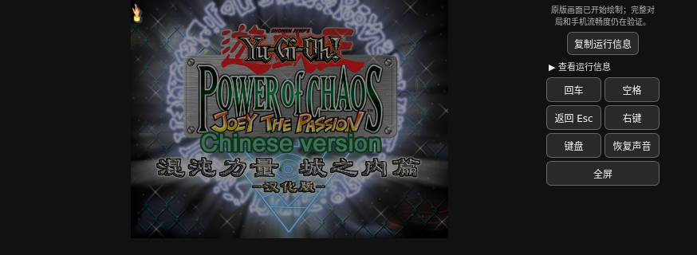
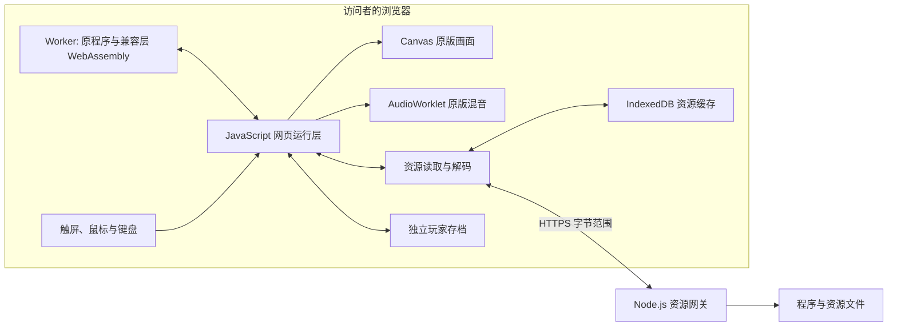

<div align="center">

# Joey Browser

**在浏览器中运行《游戏王：混沌力量 · 城之内篇》的原版程序**

WebAssembly 本机执行 · 原版界面与 AI · 手机触控 · 好友联机 · 双语字幕 · 收藏卡

[](https://github.com/Junming-Liang/joey-browser/actions/workflows/checks.yml)
[](https://github.com/Junming-Liang/joey-browser/releases)
[](LICENSE)
[](docs/VERIFICATION.md)

[在线体验](https://106.12.148.75:8443/joey/original/) · [快速开始](#快速开始) · [自行部署](#自行部署) · [开发指南](#开发与测试) · [发布记录](https://github.com/Junming-Liang/joey-browser/releases) · [报告问题](https://github.com/Junming-Liang/joey-browser/issues)

</div>

Joey Browser 为固定版本的城之内汉化程序提供浏览器兼容运行环境。原程序的 x86 机器码经静态转译生成 Rust，再编译为 WebAssembly；游戏逻辑、画面生成和混音在访问者的设备上运行，服务器负责分发程序与资源。

项目处于 **兼容性预览** 阶段，完整对局、所有卡片效果及不同实体手机的表现仍在持续验证。已验证范围见 [验证记录](docs/VERIFICATION.md)。MIT 适用于本项目自有代码与文档，原游戏和第三方内容保留各自声明，见 [许可与致谢](#许可与致谢)。



*界面示例：桌面 WebKit 的手机横屏尺寸模拟，画面保持原版 4:3 比例，辅助操作位于右侧。[截图来源与权利说明](docs/images/README.md)。*

## 导航

- [功能概览](#功能概览)
- [快速开始](#快速开始)
- [浏览器要求](#浏览器要求)
- [资源与存档](#资源与存档)
- [自行部署](#自行部署)
- [工作原理](#工作原理)
- [开发与测试](#开发与测试)
- [文档导航](#文档导航)
- [常见问题](#常见问题)
- [参与贡献](#参与贡献)
- [许可与致谢](#许可与致谢)

## 功能概览

- **原版程序运行**：沿用原程序的菜单、卡组管理、决斗逻辑和城之内 AI，原始画面为 800 × 600。
- **手机操作**：点按、拖动、右键辅助、常用按键和设备键盘；横屏按可用高度显示原版画面。
- **浏览器声音**：PCM 混音经 AudioWorklet 播放，支持通过用户操作恢复声音。
- **按需资源**：先准备常用资源，其他素材随游戏读取，也可选择安装完整资源。
- **缓存与续传**：程序、资源及未完成的下载分段保存在本机，重新打开时复用已有内容。
- **卡组与存档**：全卡解锁、预设卡组、收藏／卡组备份恢复，以及多标签独占写入保护。
- **好友联机**：通过房间码邀请两名玩家，保留原版界面和规则；服务器转发原版消息。
- **双语字幕**：设置中开启后，跟随实际语音同时显示中文和英文，默认关闭。
- **收藏卡**：凉茶、年糕、大葱、猴子、仙人掌；胜利奖励只从五张中抽取。成功发动或召唤后播放主题特殊胜利演出，只能用于单人游戏。
- **运行诊断**：下载进度、缓存、渲染和声音状态可查看、复制和反馈。

## 快速开始

1. 使用独立浏览器打开 [在线体验](https://106.12.148.75:8443/joey/original/)。iPhone／iPad 建议使用 Safari，Android 建议使用独立 Chrome。
2. 手机转为横屏，点击 **启动原版游戏**；当前在线入口无需密码。
3. 等待程序和常用资源准备完成。完整资源安装为可选项。

点按原版界面进行选择，按住卡片可拖动。需要右键时，先点目标位置，再点工具栏的 **右键**；工具栏还提供回车、空格、返回、键盘和声音恢复。当前名称输入支持英文、数字及常见英文标点。

遇到启动或运行异常时，点击 **复制运行信息**，连同具体操作步骤提交到 [Issues](https://github.com/Junming-Liang/joey-browser/issues)。

## 浏览器要求

运行环境需要 HTTPS 安全上下文、COOP／COEP 跨源隔离、WebAssembly 共享内存、Web Workers 和 AudioWorklet。玩家存档使用 IndexedDB 与 Web Locks；完整资源安装依赖可用的持久存储。

| 环境 | 当前说明 |
| --- | --- |
| 桌面 Chromium、WebKit | 已用专用配置验证启动、资源、存档及部分游戏流程，详见 [验证记录](docs/VERIFICATION.md) |
| iOS／iPadOS、Android 独立浏览器 | 以页面实际能力检测和实体设备表现为准，持续收集兼容性反馈 |
| 应用内置网页／WebView | 可能未开放共享内存；请复制链接到独立浏览器，或选择应用菜单的“在浏览器中打开” |
| 直接打开本地 HTML | 请使用匹配的 HTTP／HTTPS 网关，环境要求见 [部署指南](docs/DEPLOY.md) |

[原入口](https://106.12.148.75:8443/joey/original/)提供电脑 AI 单人游戏；[好友联机入口](https://106.12.148.75:8443/joey/online-preview/)支持房间码邀请。收藏卡需要从主卡组、副卡组及融合卡组移除后才能联机。项目绑定固定游戏输入；其他 EXE、资源版本和浏览器环境需要单独验证。

## 资源与存档

### 选择加载方式

| 方式 | 下载内容 | 适合场景 |
| --- | --- | --- |
| **按需加载，默认** | 程序与首批常用资源预计约 50 MB，其余随后读取 | 尽快开始，随游玩逐步建立缓存 |
| **完整轻量资源** | 资源包约 180 MB，另需共用程序约 16 MB | 缩小完整安装体积，减少后续资源请求 |
| **完整原画原声** | 资源包约 228 MB，另需共用程序约 16 MB | 使用无损资源包 |

MB 使用十进制。首启数字是固定常用片段的压缩估算，并非所有网络及缓存条件下的实测下载量。五张收藏卡另需约 1.1 MB 压缩增量，复用原资源缓存；完整资源和程序分开计数；精确大小、索引与解码器开销见 [资源包说明](docs/RESOURCE-PACKS.md#测量口径) 和 [version.json](version.json)。

轻量档只对卡图和声音采样做声明范围内的有损处理，界面、文字、字体、卡背、遮罩及声音采样率、声道和时长保持原样。资源下载支持续传，完整安装完成前会逐块校验持久化数据；已有完整旧资源可以继续复用。

### 玩家文件保存在当前浏览器

卡组、收藏及已写入的玩家文件保存在当前站点的浏览器存储中。关闭页面会结束当前运行；重新打开会启动游戏并读取存档，目前没有恢复整段运行内存的断点续玩功能。

存档尚未提供跨设备云同步。清除网站数据、换浏览器或换站点地址会影响存档与资源缓存；同一浏览器同时启动第二个游戏标签时，会提示先关闭占用存档的页面。

## 自行部署

**源码仓库、手机资源安装和服务器部署归档对应不同用途。** Git 源码不包含原游戏 EXE／DAT 或编译后的游戏程序；完整部署归档可携带这些固定输入和程序，手机资源安装只获取客户端运行所需内容。

### 已取得完整部署包

在 [Releases](https://github.com/Junming-Liang/joey-browser/releases) 确认对应版本实际提供的附件。`joey-browser-<版本>-complete.tar.gz` 及其校验文件属于完整部署包；GitHub 自动生成的 **Source code** 和 `*-source.zip` 均为源码包。如果发布版本只提供源码，请按下一节自行构建。

以下以 v0.3.0 完整归档为例。目标环境为 Linux、Node.js 22 及以上，并需要 `tar` 和 `sha256sum`：

```sh
sha256sum -c joey-browser-v0.3.0-complete.tar.gz.sha256
tar -xzf joey-browser-v0.3.0-complete.tar.gz
cd joey-browser-v0.3.0-local
node site/setup-deployment.mjs --origin https://game.example.com
JOEY_ORIGINAL_CONFIG="$PWD/config.local.json" \
  node --max-old-space-size=64 site/server.mjs
```

安装器校验输入、还原原始资源并生成独立配置；目标服务器无需 Rust 编译或 npm 依赖安装。服务绑定回环地址，公网访问需配置 HTTPS 反向代理，详见 [完整部署说明](docs/LOCAL-DEPLOYMENT.md)。已有服务的升级与回滚按 [部署指南](docs/DEPLOY.md) 操作。

### 从源码构建部署包

先按 [BUILD.md](docs/BUILD.md) 准备版本匹配的游戏输入、固定工具链与构建输出，再执行：

```sh
python3 scripts/package-deployment.py \
  --output .bridge/joey-browser-v0.3.0-complete.tar.gz
```

构建器核对原始输入、程序、网页文件与资源包身份，生成部署归档及同名 `.sha256` 文件。输入清单、路径参数和安装步骤见 [LOCAL-DEPLOYMENT.md](docs/LOCAL-DEPLOYMENT.md)；内容许可边界见 [游戏内容声明](GAME-CONTENT-NOTICE.md)。

## 字幕与收藏卡

启动前或运行中展开 **设置**，勾选 **中英双语字幕**。字幕跟随实际播放的城之内语音。

收藏卡不会随原版 771 种全卡解锁自动发放，需通过获胜奖励收集。凉茶成功结算、四张怪兽成功通常／特殊／反转召唤时播放各自主题演出，并进入原版胜利结算；盖放、召唤或效果被无效不触发。浏览器、运行时及服务器共同拒绝收藏卡进入联机。详见 [收藏卡实现与验证](games/joey/reverse/CUSTOM_CARDS.md)。

## 工作原理

构建阶段使用固定提交的 [Theseus](https://github.com/evmar/theseus) 分析原 EXE，生成表达机器指令行为的 Rust，再连同游戏适配和 Win32 兼容层编译为 WebAssembly。生成代码保留寄存器、内存和控制流语义，原厂的高级语言工程源码并未恢复。

运行阶段由浏览器执行程序，网页运行层承接画面、声音、输入和文件读写：



游戏规则和 AI 在访问者的设备上计算，服务器主要承担程序、资源和少量诊断请求。资源采用分块压缩和身份校验，运行时按原始文件偏移恢复所需内容。更换输入版本需要重新分析、构建和验证。

## 开发与测试

### 获取源码并执行离线检查

需要 Node.js 22 及以上和 Python 3：

```sh
git clone https://github.com/Junming-Liang/joey-browser.git
cd joey-browser
npm ci
npm test
```

`npm test` 无需原游戏文件，覆盖语法与来源校验、范围读取契约、PCM 队列、安装器还原及文件保护、部署归档与失败回滚。GitHub Actions 执行这一层检查；CI 通过不代表全部卡片效果或实体手机性能已验收。

### 构建后的浏览器检查

准备固定游戏输入和构建输出后，安装 Playwright 浏览器，按改动范围执行对应检查：

```sh
npx playwright install --with-deps chromium webkit
npm run test:startup
npm run test:landscape
npm run test:game
```

另有 `test:downloads`、`test:quality`、`test:decoder`、`test:install` 和 `test:profile`，分别覆盖续传、资源质量、解码器、完整安装和玩家文件。`JOEY_CHROMIUM_PATH` 可指定已有 Chromium。测试使用专用存档和浏览器上下文；准备方式与验证边界见 [贡献指南](CONTRIBUTING.md) 和 [验证记录](docs/VERIFICATION.md)。

## 文档导航

| 文档 | 适用读者与内容 |
| --- | --- |
| [BUILD.md](docs/BUILD.md) | 构建者：固定输入、工具链、静态转译与资源生成 |
| [LOCAL-DEPLOYMENT.md](docs/LOCAL-DEPLOYMENT.md) | 部署者：完整归档的打包、校验、安装与启动 |
| [DEPLOY.md](docs/DEPLOY.md) | 运维者：HTTPS、独立服务、升级与回滚 |
| [RESOURCE-PACKS.md](docs/RESOURCE-PACKS.md) | 开发者：压缩策略、缓存身份、续传与体积口径 |
| [VERIFICATION.md](docs/VERIFICATION.md) | 使用者与贡献者：已验证行为、版本及待验证事项 |
| [CHANGELOG.md](CHANGELOG.md) | 版本变更；公开附件以 [Releases](https://github.com/Junming-Liang/joey-browser/releases) 为准 |
| [version.json](version.json) | 当前源码对应的运行版本、原始输入与产物 SHA-256 |

```text
games/joey/
├── original/       # 网页、运行层、存档、网关与浏览器检查
└── reverse/        # 转译工具、兼容补丁、资源与音频模块
build-inputs/       # 固定转换入口与导入审计
deploy/             # 反向代理与独立服务配置示例
docs/               # 构建、部署、资源、验证与界面截图
scripts/            # 源码核对与部署包工具
releases/           # 版本说明
```

`.bridge/` 为本地工作目录，不提交游戏原始输入、生成程序、资源包、浏览器存档或认证配置。源码随附的第三方 Brotli 解码器 WASM 有独立的来源、许可和校验值。

## 常见问题

**缺少共享内存，或应用内置网页无法启动？**

复制链接到独立浏览器，或选择应用菜单的“在浏览器中打开”。同一内核版本的内置网页与独立浏览器可能开放不同能力。页面在准备阶段检查实际能力，异常时提供可复制的诊断。

**多人可以同时打开吗？**

可以。多人可以各自在浏览器中进行单人游戏，也可以通过好友联机入口用房间码邀请对战。玩家存档各自独立；同一浏览器的单人和联机入口共用该站点存档。切换后台时网页可能被挂起或回收，关闭页面会结束自己的运行；联机时对手也会收到连接结束通知。

**下载中断、刷新或更新后，需要重新安装吗？**

程序和资源按段保存，重新打开会继续获取未保存的部分。已有完整旧资源优先复用；选择原画原声时不会用轻量缓存替代。清除站点数据或浏览器回收存储会影响这些内容。

**为什么服务器部署包比手机完整资源安装更大？**

服务器归档包含原 EXE、浏览器程序和两档资源包；手机只下载运行所需的程序及选定资源。两者用途和包含内容不同，比较体积时应先确认下载对象。

**可以加载任意 EXE，或者保证所有手机都流畅吗？**

转换结果绑定固定游戏输入和已实现的兼容接口。其他程序需要单独分析与适配；浏览器能力、设备资源及缓存状态也影响运行。完整胜负、全部卡片效果、重放、中文输入法和更多实体设备仍需继续验证，详见 [验证记录](docs/VERIFICATION.md)。

## 参与贡献

欢迎提交兼容性修复、可复现的性能记录、资源读取改进与文档更新。请先阅读 [CONTRIBUTING.md](CONTRIBUTING.md)。

- **报告问题**：提供运行版本、系统与浏览器、具体操作、预期和实际结果，并附经检查的运行信息。
- **改进实现**：保持原文件偏移、缓存身份、输入顺序与玩家存档隔离，附相关验证命令和未覆盖范围。
- **反馈手机表现**：说明场景、网络和缓存状态，区分持续卡顿、加载等待与声音中断。
- **报告安全问题**：按 [SECURITY.md](SECURITY.md) 处理，不在公开 Issue 中粘贴密钥、服务器私有配置或私人存档。

当前重点是原版完整流程的覆盖、移动浏览器稳定性与资源读取体验。功能或性能变化应由可复现的实际场景支持。

## 许可与致谢

本项目自有代码和文档采用 **[MIT License](LICENSE)**。原游戏程序、资源、截图中的图像与商标，以及第三方组件保留各自版权和许可。完整游戏内容的附件分发说明见 [GAME-CONTENT-NOTICE.md](GAME-CONTENT-NOTICE.md)。

- [Theseus](https://github.com/evmar/theseus)：x86 静态转译和基础 Win32 兼容实现。本仓库发布固定版本的适配补丁；该上游固定提交未附许可证，本项目不替上游授予 MIT 许可。
- [brotli-dec-wasm](https://github.com/ustclug-dev/brotli-dec-wasm)：资源解码器，保留 MIT／Apache-2.0 声明与修改记录。
- WenQuanYi Micro Hei：兼容字形数据采用其提供的 Apache-2.0 许可选项。
- [Playwright](https://github.com/microsoft/playwright)：Chromium／WebKit 浏览器验证工具。
- 卡组配方整理者及兼容性反馈者：来源与配方记录保留在对应目录中。

完整来源、固定版本与分发边界见 [THIRD_PARTY_NOTICES.md](THIRD_PARTY_NOTICES.md)。
